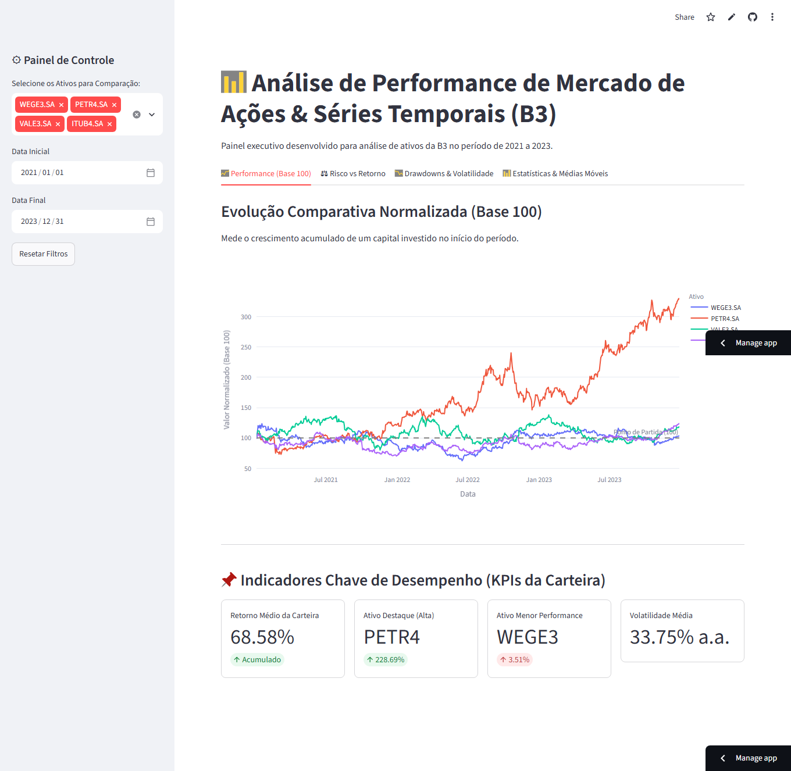
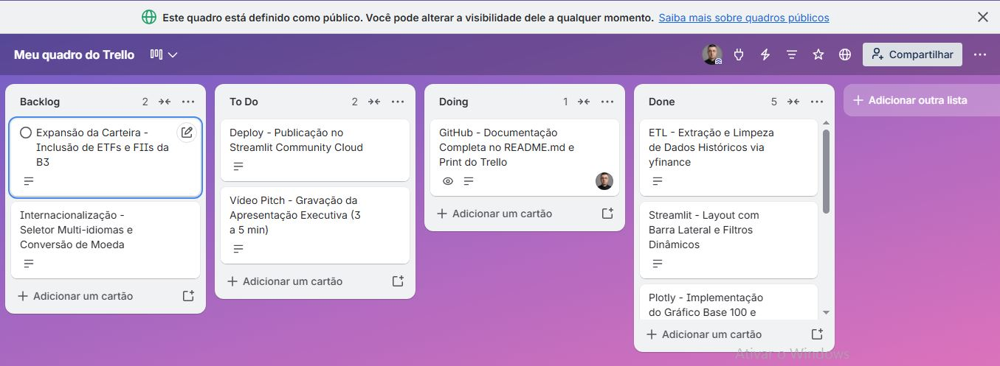

# 📊 Dashboard de Performance de Mercado de Ações & Séries Temporais (B3)

Painel executivo interativo desenvolvido em Python e Streamlit para análise de ativos da B3 no período de 2021 a 2023, integrando engenharia de dados, visualizações analíticas em Plotly e boas práticas de gestão ágil.

---

## 1. Título e Resumo Executivo
* **Nome da Solução:** BI Analytics Financeiro - B3 Performance Tracker
* **Resumo:** Aplicação corporativa desenvolvida para apoiar investidores e analistas na avaliação de rentabilidade, volatilidade, drawdowns e tendências de ativos líquidos da B3 entre os anos de 2021 e 2023.
## Demonstração Visual do Painel


## 2. Contexto de Negócio e Pergunta Orientadora
* **Desafio:** No mercado de capitais moderno, a tomada de decisão baseada em evidências estatísticas e visuais é crucial. Este projeto responde a perguntas fundamentais de negócio, como: *Qual seria a rentabilidade comparativa de um capital investido no início de 2021? Quais ativos entregaram a melhor relação de risco-retorno e menor drawdown?*

## 3. Fonte de Dados e Licença
* **Origem:** Dados históricos diários de cotações obtidos via API pública oficial do Yahoo Finance (`yfinance`) para ativos listados na B3.
* **Período Histórico:** 01/01/2021 a 31/12/2023.

## 4. Pipeline de Engenharia de Dados (ETL)
* Extração automatizada via loop robusto com a biblioteca `yfinance`.
* Tratamento de valores ausentes utilizando preenchimento direcional (`ffill`/`bfill`).
* Tratamento de índices temporais e padronização de colunas numéricas em formato `float`.

## 5. Dicionário de Dados
| Coluna / Variável | Tipo Primitivo | Significado Financeiro / Descrição |
| :--- | :--- | :--- |
| `Date` | Datetime | Data do pregão histórico |
| `Adj Close` | Float | Preço de fechamento ajustado por proventos e bonificações |
| `Base 100` | Float | Índice normalizado considerando o ponto de partida igual a 100 |
| `Volatilidade` | Float | Desvio padrão anualizado dos retornos diários (% a.a.) |

## 6. Tecnologias e Bibliotecas
* **Python:** Linguagem base de programação.
* **Streamlit:** Framework para construção do Data App interativo na nuvem.
* **Pandas & NumPy:** Manipulação, limpeza e modelagem estatística dos dados.
* **Plotly Express:** Biblioteca para construção de gráficos analíticos interativos.
* **yfinance:** Extração de dados de mercado financeiro.

## 7. Principais Resultados e Evidências Numéricas
* Identificação dos ativos de maior destaque em rentabilidade acumulada na janela de 3 anos.
* Mensuração precisa do risco através da volatilidade anualizada e curvas de drawdown máximo.

## 8. Discussão e Limitações da Análise
* *Limitação:* Os resultados refletem o comportamento histórico de 2021 a 2023[cite: 1], não garantindo rentabilidade futura. Relações estatísticas observadas não implicam causalidade direta sem análise macroeconômica complementar.

## 9. Aplicação Profissional e Decisões de Negócio
* O painel serve como ferramenta de suporte para gestores de portfólio e analistas de investimentos na rápida triagem de desempenho setorial e de papéis na B3.

## 10. Demonstração do Data App (Streamlit)
* **Link Público da Aplicação:** [https://danielmusashi79-projeto-final-acoes-b3-app-rslyvh.streamlit.app](https://danielmusashi79-projeto-final-acoes-b3-app-rslyvh.streamlit.app)

## 11. Como Executar Localmente
1. Clone o repositório:
   ```bash
   git clone [https://github.com/DanielMusashi79/projeto-final-acoes-b3.git](https://github.com/DanielMusashi79/projeto-final-acoes-b3.git)

## 12. Gestão Ágil, Evidências e Links do Projeto
* **Quadro Kanban (Trello - Público):** [https://trello.com/b/uSCURscW/meu-quadro-do-trello]
* **Print do Quadro Trello (Kanban):**
  
* **Link do Vídeo de Apresentação (Pitch):** [Inserir link do vídeo executivo]